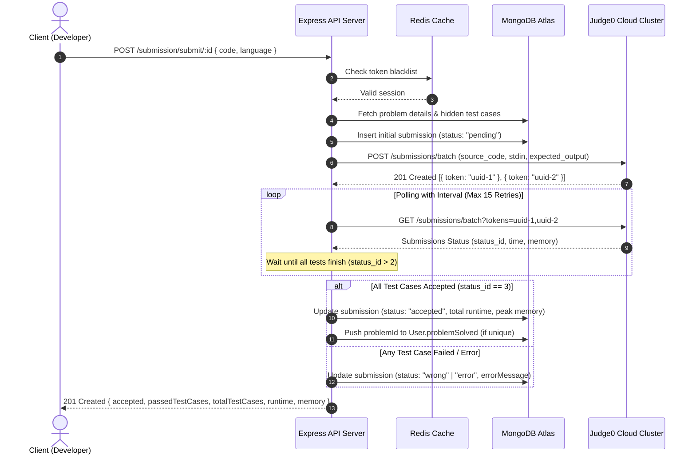
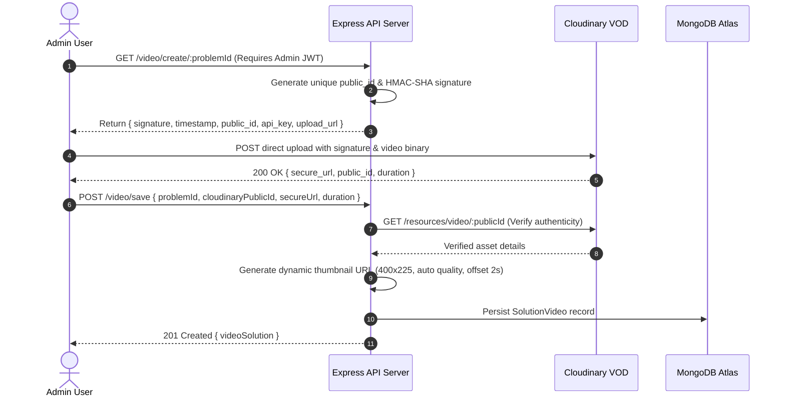
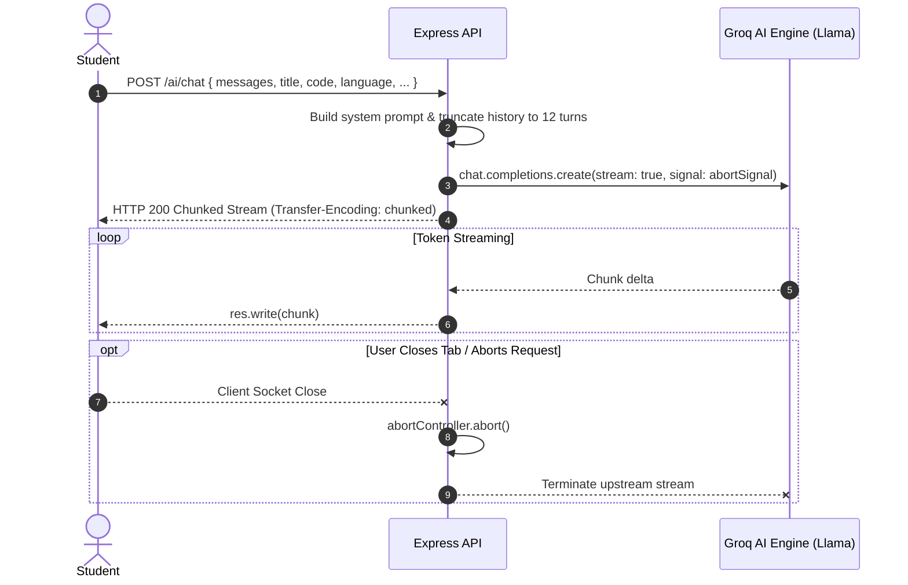
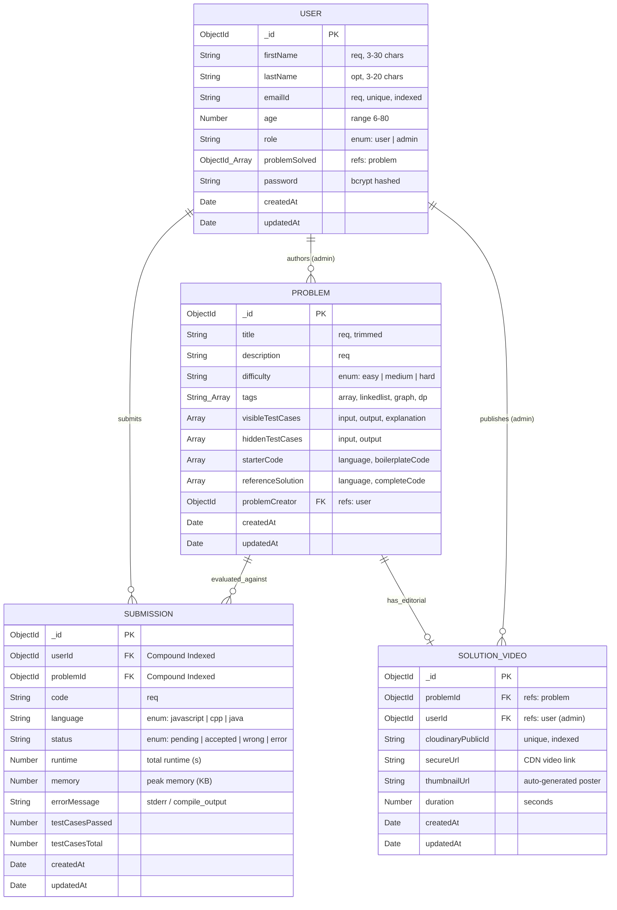

<div align="center">

# 🚀 NexCode — Scalable Online Judge & Distributed Learning Platform Backend

**An enterprise-grade, high-throughput RESTful backend engine powering a competitive programming platform with sandboxed remote code execution, real-time AI doubt solving, and direct-to-cloud video solution pipelines.**

[](https://nodejs.org/)
[](https://expressjs.com/)
[](https://www.mongodb.com/)
[](https://redis.io/)
[](https://judge0.com/)
[](https://groq.com/)
[](https://ai.google.dev/)
[](https://cloudinary.com/)

---

[Key Highlights](#-key-engineering-highlights) •
[System Architecture](#-system-architecture) •
[Data Models & ERD](#-entity-relationship-erd-diagram) •
[API Reference](#-complete-api-reference) •
[Engineering Trade-offs](#-deep-dive-engineering-decisions--trade-offs) •
[Quickstart](#-getting-started)

</div>

---

## 📌 Executive Summary

**NexCode Backend** is designed from the ground up to solve the real-world engineering bottlenecks of competitive programming systems: **safely evaluating untrusted user code at scale**, **streaming low-latency pedagogical AI feedback**, and **serving high-bandwidth video editorial solutions without blocking the Node.js event loop**.

Built with Express 5, MongoDB, and Redis, it implements a decoupled, event-driven pattern for Remote Code Execution (RCE), an HMAC-SHA signed media ingestion pipeline via Cloudinary, and a dual-LLM tutoring assistant featuring HTTP chunked streaming with automatic connection abort handling.

---

## 🌟 Key Engineering Highlights

### ⚡ 1. Asynchronous Remote Code Execution (RCE) Pipeline
- **Sandboxed Multi-Language Evaluation:** Executes C++ (ID: 54), Java (ID: 62), and JavaScript (ID: 102) in isolated compute sandboxes via the Judge0 API.
- **Two-Tier Execution Lifecycle:**
  - **Dry Run (`/run/:id`):** Stateless compilation and execution against visible test cases for rapid debugging feedback without database writes.
  - **Formal Evaluation (`/submit/:id`):** Secure execution against encrypted/hidden test cases with execution time profiling, peak memory tracking, atomic status verdicts (`accepted`, `wrong`, `error`), and real-time user solved counter increments.
- **Batched Submission & Non-Blocking Polling:** Submits multiple test cases concurrently using batch endpoints and polls execution tokens with bounded retry cycles (`MAX_TRIES = 15`), preserving the Node.js single-threaded event loop.
- **Problem Authoring Sanity Assurance:** Automatically evaluates reference solutions against test cases during problem creation or mutation, rejecting invalid problem definitions before they reach production.

### 🛡️ 2. Resilient Authentication & Redis Token Blacklisting
- **Stateless JWT with State-Aware Invalidation:** JWTs are issued via hardened `httpOnly`, `secure`, `SameSite: None` cookies to prevent XSS exfiltration.
- **O(1) Redis Blacklisting on Logout:** Solves the core limitation of JWTs (inability to invalidate before expiration) by persisting logged-out signatures in Redis with a dynamic TTL (`expireAt: payload.exp`), reclaiming memory automatically while ensuring millisecond-level verification in middleware.
- **Role-Based Access Control (RBAC):** Strict operational separation between `user` and `admin` roles, guarding mutation routes, test case configurations, and video uploads.
- **Cascading Lifecycle Cleanup:** Purges all corresponding submissions atomically when a user account is deleted.

### 🤖 3. AI-Powered Real-Time Doubt Solving & Code Tutor
- **High-Throughput Streaming Engine:** Integrated with **Groq SDK** (`openai/gpt-oss-20b`) for ultra-low latency token generation, with a secondary integration for **Google Gemini 3.8 Flash**.
- **Real-Time HTTP Chunked Streaming:** Streams token chunks over `text/plain` chunked transfer encoding (`X-Accel-Buffering: no`, `res.flush()`), drastically reducing perceived latency (TTFT) for students.
- **Client Disconnection Reclamation:** Uses Node.js `AbortController` bound to the client socket `close` event to terminate streaming and cancel upstream LLM requests when a client navigates away, eliminating wasted API costs.
- **Context-Aware Algorithmic Prompting:** Injects problem title, description, constraints, starter code, and active user submissions into the system prompt with strict pedagogical guardrails (hints before code, edge case traps, $O(N)$ vs $O(N^2)$ complexity breakdowns, sliding window of 12 recent messages).

### 📹 4. Direct-to-Cloud Signed Video Solution Pipeline
- **Zero-Hop Video Uploads:** Employs Cloudinary API HMAC-SHA signatures (`api_sign_request`) generated on the backend. Clients stream multi-megabyte video solutions directly to the CDN, preventing Node.js process memory spikes and reverse-proxy timeouts.
- **Automatic Asset Validation & Ingestion:** Post-upload verification against Cloudinary's Admin API before saving metadata to MongoDB.
- **Dynamic Poster Frame Generation:** Automatically transforms and extracts optimized video thumbnails (`400x225`, auto quality, 2-second offset) on upload.
- **Atomic Cloudinary Deletion:** Synchronously purges both database metadata and Cloudinary CDN assets when an admin removes a solution.

### 🗄️ 5. Optimized MongoDB Schema & Indexing Strategy
- **Compound B+ Tree Indexing:** Implemented compound index `{ userId: 1, problemId: 1 }` on `Submission` collection, driving sub-millisecond $O(\log N)$ lookups for user problem submission histories.
- **Mongoose `.lean()` Read Optimizations:** Bypasses Mongoose change-tracking and virtual hydration overhead on read paths, reducing V8 heap usage during heavy reads.
- **Deep Document Population:** Cleanly populates solved problem metadata with selective field projections (`title difficulty tags`).

---

## 🏗️ System Architecture

```mermaid
flowchart TB
    subgraph Clients["Clients"]
        Web["Web Client / SPA"]
    end

    subgraph Gateway["API Gateway / Node.js Express 5 Engine"]
        AuthMid["Auth & RBAC Middleware"]
        Router["Express Routers (/user, /problem, /submission, /ai, /video)"]
        StreamHandler["AI SSE / Chunk Streamer"]
        SignatureGen["Cloudinary Signature Gen"]
    end

    subgraph DataStore["Persistence & Cache Layer"]
        MongoDB[(MongoDB Atlas)]
        Redis[(Redis Cloud)]
    end

    subgraph ThirdParty["External Distributed Services"]
        Judge0["Judge0 Remote Code Execution API"]
        Groq["Groq Cloud LLM (gpt-oss-20b)"]
        Gemini["Google Gemini 3.8 Flash"]
        Cloudinary["Cloudinary Video CDN"]
    end

    Web -->|HTTP Requests / Cookies| Gateway
    AuthMid -->|Verify JWT & Check Blacklist O(1)| Redis
    Router -->|Read / Write Models| MongoDB
    Router -->|Batch Code Submissions & Polling| Judge0
    StreamHandler -->|Abortable LLM Token Stream| Groq
    StreamHandler -.->|Fallback Tutor Content| Gemini
    SignatureGen -->|Sign Upload Payload| Web
    Web -->|Direct Upload Signed Video| Cloudinary
    Router -->|Verify & Store Metadata| Cloudinary
```

---

## 🔄 Core Execution Workflows

### 1. Sandboxed Code Submission Pipeline



### 2. High-Performance Direct Video Upload Architecture



### 3. Abortable AI Doubt Solver Stream



---

## 🗃️ Entity Relationship (ERD) Diagram



---

## 🔌 Complete API Reference

All protected endpoints expect a valid JWT cookie named `token`.

### 🔐 1. Authentication Service (`/user`)

| Method | Endpoint | Access | Description | Request Body / Params |
| :--- | :--- | :--- | :--- | :--- |
| `POST` | `/user/register` | Public | Register standard user & receive `httpOnly` cookie | `{ firstName, emailId, password, lastName?, age? }` |
| `POST` | `/user/login` | Public | Authenticate user credentials & set cookie | `{ emailId, password }` |
| `POST` | `/user/logout` | User / Admin | Blacklist token in Redis with dynamic TTL & clear cookie | _None (Reads Cookie)_ |
| `POST` | `/user/admin/register` | Admin | Register a new administrative account | `{ firstName, emailId, password, role: "admin" }` |
| `GET` | `/user/check` | User / Admin | Validate active session & return sanitized profile | _None (Reads Cookie)_ |
| `DELETE`| `/user/delete` | User / Admin | Cascade-delete user profile & all user submissions | _None (Reads Cookie)_ |

### 🧩 2. Problem Management Service (`/problem`)

| Method | Endpoint | Access | Description | Request Body / Params |
| :--- | :--- | :--- | :--- | :--- |
| `POST` | `/problem/create` | Admin | Validate solutions via Judge0 & save problem | `{ title, description, difficulty, tags, visibleTestCases, hiddenTestCases, starterCode, referenceSolution }` |
| `PUT` | `/problem/update/:id` | Admin | Re-validate solution & update problem document | Route Param: `id`<br/>Body: Updated fields |
| `DELETE`| `/problem/delete/:id` | Admin | Permanently delete problem | Route Param: `id` |
| `GET` | `/problem/problemById/:id` | User / Admin | Fetch problem details + attached solution video | Route Param: `id` |
| `GET` | `/problem/getallproblem` | User / Admin | List all problems (projected fields with `.lean()`) | _None_ |
| `GET` | `/problem/problemsolvedbyuser` | User / Admin | Fetch full list of problems solved by active user | _None_ |
| `GET` | `/problem/submittedproblem/:pid` | User / Admin | Fetch all submissions for a problem (Compound indexed) | Route Param: `pid` |

### ⚙️ 3. Sandboxed Code Execution Service (`/submission`)

| Method | Endpoint | Access | Description | Request Body / Params |
| :--- | :--- | :--- | :--- | :--- |
| `POST` | `/submission/run/:id` | User / Admin | Dry-run code on visible test cases (stateless) | Route Param: `id`<br/>Body: `{ code, language }` |
| `POST` | `/submission/submit/:id`| User / Admin | Evaluate on hidden test cases & persist record | Route Param: `id`<br/>Body: `{ code, language }` |

*Supported Languages: `cpp` (Judge0 ID: 54), `java` (Judge0 ID: 62), `javascript` (Judge0 ID: 102).*

### 🤖 4. AI Doubt Solver & Pedagogical Tutor (`/ai`)

| Method | Endpoint | Access | Description | Request Body / Params |
| :--- | :--- | :--- | :--- | :--- |
| `POST` | `/ai/chat` | User / Admin | Real-time HTTP chunked streaming AI tutoring | `{ messages: [{ role, parts: [{ text }] }], title, description, testCases, startCode, userCode, language }` |

*Features: Connection drop auto-cancellation via `AbortController`, sliding window conversation retention (12 turns), strict Markdown responses.*

### 📹 5. Video Editorial Service (`/video`)

| Method | Endpoint | Access | Description | Request Body / Params |
| :--- | :--- | :--- | :--- | :--- |
| `GET` | `/video/create/:problemId` | Admin | Generate Cloudinary HMAC-SHA direct upload signature | Route Param: `problemId` |
| `POST` | `/video/save` | Admin | Verify Cloudinary upload & store metadata + poster | `{ problemId, cloudinaryPublicId, secureUrl, duration }` |
| `DELETE`| `/video/delete/:problemId` | Admin | Destroy asset from Cloudinary CDN & delete DB doc | Route Param: `problemId` |

---

## 🧠 Deep Dive: Engineering Decisions & Trade-offs

### 1. Redis Token Blacklisting vs. Stateful Sessions or Traditional JWTs
* **The Problem:** Pure stateless JWTs cannot be revoked on logout before their expiration timestamp, creating a critical vulnerability if credentials or session cookies are intercepted. Conversely, database-backed stateful sessions require an expensive database hit on every API request.
* **The Architecture:** NexCode maintains the horizontal scalability of stateless JWT verification, but combines it with an in-memory **Redis Blacklist with Dynamic TTL**:
  $$\text{TTL} = \text{payload.exp} - \text{currentTime}$$
  When a user logs out, the token is written to Redis using `expireAt(payload.exp)`. Incoming requests check Redis with an $O(1)$ `EXISTS` call. Expired tokens are purged by Redis automatically with zero memory leaks.

### 2. Direct-to-Cloud Video Ingestion vs. Server-Proxied Uploads
* **The Problem:** Routing large MP4/MOV video files through the Node.js server (e.g. using `multer`) saturates memory buffers, ties up network sockets, and easily blocks the single-threaded event loop for concurrent users.
* **The Architecture:** The server generates a pre-signed HMAC-SHA signature using the Cloudinary API secret. The client streams the video directly to Cloudinary. The backend only handles a tiny JSON metadata payload upon completion and generates high-efficiency thumbnail transformations on the fly.

### 3. Abortable HTTP Streaming vs. Polling or Buffering for AI Responses
* **The Problem:** DSA tutoring queries can yield hundreds of tokens. Buffering the full response causes multi-second user latency (poor UX) and leaves the backend vulnerable to wasted upstream token costs if the user cancels or closes their browser.
* **The Architecture:** The `/ai/chat` endpoint leverages chunked HTTP streaming (`Transfer-Encoding: chunked`). It attaches an `AbortController` to the client response `close` event:
  ```javascript
  res.on('close', () => {
    if (!res.writableEnded) abortController.abort();
  });
  ```
  If a user switches tabs or stops the query, the upstream Groq LLM inference halts immediately, protecting server resources and billing quotas.

### 4. Compound B+ Tree Indexing on Submissions
* **The Problem:** The `Submission` collection grows at an order of magnitude faster than users or problems. Queries filtering user submission histories (`{ userId, problemId }`) default to full collection scans ($O(N)$), causing high disk I/O and query latency.
* **The Architecture:** Created a compound index:
  ```javascript
  submissionSchema.index({ userId: 1, problemId: 1 });
  ```
  In MongoDB B+ Trees, this index satisfies queries filtering by `userId` alone, as well as `userId` + `problemId` pairs in $O(\log N)$ time, sorted by chronological order.

---

## 📁 Repository Directory Structure

```text
├── src/
│   ├── config/
│   │   ├── db.js                 # MongoDB connection initialization via Mongoose
│   │   └── redis.js              # Redis cloud client setup and connection logic
│   ├── controllers/
│   │   ├── groqDoubtSolver.js    # Ultra-fast AI streaming doubt tutor (Groq SDK)
│   │   ├── solveDoubt.js         # Companion Google Gemini 3.8 Flash AI solver
│   │   ├── userAuthenticate.js   # Registration, JWT issuance, Redis logout, profile
│   │   ├── userProblems.js       # Problem CRUD, reference solution verification
│   │   ├── userSubmission.js     # Judge0 batch dispatch, polling & verdict scoring
│   │   └── videoSection.js       # Cloudinary signed upload, metadata & thumbnail
│   ├── middleware/
│   │   ├── adminMiddleware.js    # Role verification: admin access only + blacklist check
│   │   └── userMiddleware.js     # Role verification: authenticated user + blacklist check
│   ├── models/
│   │   ├── problems.js           # Problem schema (testcases, starter/ref code)
│   │   ├── solutionVideo.js      # Video metadata & Cloudinary public_id mapping
│   │   ├── submission.js         # Execution history schema with compound index
│   │   └── user.js               # User identity, bcrypt credentials, solved array
│   ├── routes/
│   │   ├── aiChatting.js         # AI doubt solver routes
│   │   ├── problemCreator.js     # Problem administration & discovery routes
│   │   ├── submit.js             # Code execution & dry run routes
│   │   ├── userAuth.js           # User authentication routes
│   │   └── videoCreator.js       # Video solution signed upload routes
│   ├── utils/
│   │   ├── problemUtility.js     # Judge0 batch submission & exponential polling utility
│   │   └── validate.js           # Validation helper (validator.js) for input sanitation
│   └── index.js                  # Application entry point, Express setup & server bootstrap
├── .env.example                  # Environment configuration template
├── package.json                  # Dependencies and execution scripts
└── README.md                     # Comprehensive project documentation
```

---

## 🚀 Getting Started

### Prerequisites

Ensure you have the following installed and configured:
- **Node.js** (v18.0.0 or higher recommended)
- **MongoDB** (Local instance or MongoDB Atlas URI)
- **Redis** (Local instance or Redis Cloud instance)
- **Judge0 API Key** (or use the open endpoint `https://ce.judge0.com`)
- **Groq API Key** (from [Groq Console](https://console.groq.com/))
- **Google Gemini API Key** (optional companion AI from [Google AI Studio](https://aistudio.google.com/))
- **Cloudinary Account** (Cloud name, API Key, API Secret from [Cloudinary Dashboard](https://cloudinary.com/))

### 1. Clone the Repository

```bash
git clone https://github.com/your-username/leetcode-backend.git
cd leetcode-backend
```

### 2. Install Dependencies

```bash
npm install
```

### 3. Configure Environment Variables

Create a `.env` file in the root directory:

```bash
cp .env.example .env
```

Populate the required configuration values:

```env
# Server Configuration
PORT=3000

# Database & Caching
DB_URI=mongodb+srv://<username>:<password>@cluster0.mongodb.net/leetcode?retryWrites=true&w=majority
SECRET_KEY=your_super_secure_jwt_secret_key_minimum_32_characters

# Redis Cloud Configuration
REDIS_HOST=your-redis-host.db.redis.io
REDIS_PORT=14051
REDIS_PASS=your_redis_password

# AI Tutor Integrations
GROQ_API_KEY=gsk_your_groq_api_key_here
GEMINI_KEY=your_gemini_api_key_here

# Cloudinary Media Configuration
CLOUDINARY_CLOUD_NAME=your_cloudinary_cloud_name
CLOUDINARY_API_KEY=your_cloudinary_api_key
CLOUDINARY_API_SECRET=your_cloudinary_api_secret
```

### 4. Run the Server

**Development Mode (with auto-reload):**
```bash
npm run dev
```

**Production Mode:**
```bash
npm start
```

Once running, the server will connect concurrently to MongoDB and Redis before listening on `http://localhost:3000`.

---

## 🔒 Security Best Practices Implemented

- **Credential Hashing:** Passwords hashed with salt rounds via `bcrypt` prior to persistence.
- **Cookie Hardening:** Session JWTs configured with `httpOnly: true` (prevents JavaScript access), `secure: true` (requires HTTPS), and `sameSite: 'None'`.
- **Input Validation:** Enforces strict validation for email formatting and strong password entropy using `validator`.
- **Resource Integrity Validation:** Guarantees that problem authors can only save problems whose reference solutions execute and pass all visible test cases cleanly.
- **Fail-Safe Disconnects:** Aborts costly LLM completions immediately if the client disconnects, preventing compute denial-of-service.

---

## 👨‍💻 Author

**Souhardya Maji**  
Backend & Systems Software Engineer  

[](https://linkedin.com/)
[](https://github.com/)

---

<div align="center">
  <sub>Built with precision, scalability, and clean code standards. Pull requests and issues welcome!</sub>
</div>
